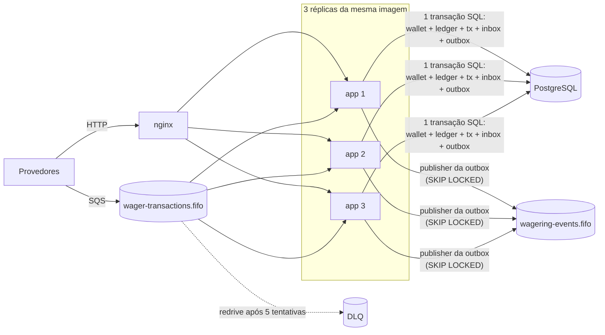

# Arquitetura

Este documento explica **como** o serviço garante as invariantes do desafio e **por que** cada
decisão foi tomada, incluindo o que foi deixado de fora. Para rodar o projeto, veja o
[README](README.md).

**Princípio central:** o banco é a última linha de defesa. A aplicação toma as decisões
financeiras sob um lock por wallet, mas **toda** garantia de unicidade, imutabilidade,
não-negatividade e consistência saldo↔ledger também é imposta pelo schema do PostgreSQL. Um bug
na aplicação vira um erro, não um saldo corrompido (isso foi provado por teste de mutação, ver
[§13](#13-testes)).

## Sumário

1. [Visão geral](#1-visão-geral)
2. [Camadas e módulos](#2-camadas-e-módulos)
3. [Modelo de domínio](#3-modelo-de-domínio)
4. [Persistência: MikroORM, Money e estratégia transacional](#4-persistência-mikroorm-money-e-estratégia-transacional)
5. [Garantias no schema](#5-garantias-no-schema)
6. [Concorrência](#6-concorrência)
7. [Idempotência](#7-idempotência)
8. [Regras de negócio e interpretações](#8-regras-de-negócio-e-interpretações)
9. [Códigos de falha e status HTTP](#9-códigos-de-falha-e-status-http)
10. [Consumidor SQS](#10-consumidor-sqs)
11. [Transactional outbox](#11-transactional-outbox)
12. [Observabilidade](#12-observabilidade)
13. [Testes](#13-testes)
14. [Autenticação](#14-autenticação)
15. [Trade-offs e limitações](#15-trade-offs-e-limitações)

---

## 1. Visão geral

Uma requisição (HTTP ou mensagem) percorre sempre o mesmo caminho:

1. validação do contrato (Zod + `Money.from`), sem I/O;
2. consulta da Idempotency-Key **sem lock** (replays saem aqui, baratos);
3. `SELECT … FOR UPDATE` na wallet: todas as operações de uma wallet ficam serializadas;
4. nova consulta da Idempotency-Key **sob o lock** (um gêmeo concorrente pode ter acabado de
   commitar);
5. regras de negócio puras (`applyWagerTransaction`) sobre `Wallet` e `WagerTransaction`;
6. **uma** transação SQL grava transação, lançamento, wallet, inbox (se veio da fila) e os
   eventos na outbox. O COMMIT dispara as verificações adiadas do schema.

Só depois do COMMIT a resposta HTTP sai e a mensagem SQS é confirmada (ack). Os eventos só
saem da outbox depois do COMMIT, por outro processo.

## 2. Camadas e módulos

| Camada          | Conteúdo                                                                                                                      | Pode depender de           |
| --------------- | ----------------------------------------------------------------------------------------------------------------------------- | -------------------------- |
| **domain**      | `Money`, `Wallet`, `WalletLedgerEntry`, `WagerTransaction`, `InboxMessage`, `OutboxMessage`, eventos, `applyWagerTransaction` | nada (nem NestJS, nem ORM) |
| **application** | use cases, portas (`UnitOfWork`, repositórios, `Clock`, `IdGenerator`, `AppMetrics`, `EventPublisher`, `OutboxStore`)         | domain                     |
| **infra**       | MikroORM (records, `EntitySchema`, mappers, unit of work), SQS, workers                                                       | application, domain        |
| **http**        | controllers, validação, filtro de exceções                                                                                    | application                |

- O domínio usa **construtor privado + factories** (`create`/`open`/`from` validam;
  `rehydrate` só reconstrói estado persistido, sem revalidar transições).
- Persistência por **records planos + mappers**: o ORM nunca vê as entidades de domínio.
- Logs e métricas são _cross-cutting_: a aplicação chama a porta `AppMetrics` e as funções de
  contexto de log (que são no-op fora de um contexto).
- Os módulos se comunicam por portas: wagering usa wallet e messaging pelo domínio e pela
  unidade de trabalho, não por chamadas entre controllers.

## 3. Modelo de domínio

**`Money`** é imutável e guarda o valor como **`bigint` em centavos**. Não existe `number` nem
float em nenhum ponto do caminho do dinheiro: contrato (string decimal), domínio (bigint),
banco (`numeric(20,2)`, lido como string pelo driver). A entrada aceita no máximo 2 casas e
rejeita `NaN`, `Infinity`, notação científica, string vazia, sinal e zero à esquerda. **Nunca
arredonda**: um valor com 3 casas é rejeitado, não ajustado. Operações entre moedas diferentes
lançam erro de domínio. O modelo é multimoeda; os testes usam BRL e USD para provar o conflito.

**`Wallet`** (aggregate root): `debit`/`credit` **devolvem o lançamento** correspondente, então
saldo e ledger não têm como divergir em memória. A `version` começa em 1 e só incrementa
quando o saldo muda. O saldo nunca fica negativo.

**`WalletLedgerEntry`** não tem campos mutáveis nem métodos de transição (imutabilidade
estrutural). A factory valida `balanceBefore ± money = balanceAfter`. Guarda `walletVersion`
(a versão da wallet após o lançamento; a abertura é a versão 1), que o schema usa para
detectar perda de atualização.

**`WagerTransaction`**: transições explícitas; estados terminais lançam erro se tocados.

| De                                | Para                     | Quando                                                         |
| --------------------------------- | ------------------------ | -------------------------------------------------------------- |
| `PENDING`                         | `PROCESSED`              | regras aplicadas                                               |
| `PENDING`                         | `REJECTED`               | violação de regra de negócio (com `failureCode`)               |
| `PENDING`                         | `PENDING_REFERENCE`      | a transação referenciada ainda não existe ou não terminou      |
| `PENDING_REFERENCE`               | `PENDING_REFERENCE`      | nova tentativa sem sucesso (conta tentativa, agenda a próxima) |
| `PENDING_REFERENCE`               | `PROCESSED` / `REJECTED` | referência resolvida, ou tentativas esgotadas                  |
| `PENDING`/`PENDING_REFERENCE`     | `FAILED`                 | erro permanente de infraestrutura (ver limitações)             |
| `PROCESSED`, `REJECTED`, `FAILED` | —                        | **terminais**: transicionar é erro de programação              |

`PENDING` nunca é persistido: a transação nasce e é resolvida na mesma transação SQL. Cada
transação guarda o **saldo observado** quando foi resolvida (`resultBalance`), para que o
replay devolva a resposta original e não o saldo atual.

## 4. Persistência: MikroORM, Money e estratégia transacional

**Por que MikroORM (e não TypeORM):** é o preferencial do desafio, e tem `EntityManager` com
_unit of work_ e _identity map_ explícitos, `em.transactional()` e `LockMode` (incluindo
`PESSIMISTIC_PARTIAL_WRITE` = `FOR UPDATE SKIP LOCKED`, usado na outbox). Usei a versão 7 com
`EntitySchema`, sem decorators, porque assim o domínio fica livre do ORM.

**Mapeamento do `Money`:** duas colunas, `numeric(20,2)` + `char(3)`. O MikroORM 7 lê `decimal`
como **string**; o mapper converte com `Money.from`. O saldo observado pela transação tem a sua
própria coluna de moeda (`result_balance_currency`), porque numa rejeição por
`CURRENCY_MISMATCH` a moeda da transação difere da moeda da wallet.

**Estratégia transacional:** um `em.fork().transactional()` por operação, com nível
**READ COMMITTED**. É suficiente porque toda decisão financeira é tomada **segurando o lock de
linha da wallet**, e o schema revalida as invariantes no COMMIT. A primeira instrução de cada
transação é `SET LOCAL lock_timeout`, que limita a espera pelo lock (padrão 5 s; depois disso,
503 retentável). Os erros do driver são traduzidos para a camada de aplicação:
violação de unique vira `UniqueViolationError(constraint)`, e deadlock, lock timeout,
serialização ou falha de conexão viram `TransientInfrastructureError`.

**Migrations** são escritas à mão (constraints e triggers não são geráveis), versionadas e
reversíveis (`up`/`down` testados). O schema é do migration, nunca do ORM.

## 5. Garantias no schema

Todas são verificadas por testes que tentam violá-las diretamente com SQL
([test/integration/schema.test.ts](test/integration/schema.test.ts)).

| Garantia                                                                  | Como                                                                                                                                                    |
| ------------------------------------------------------------------------- | ------------------------------------------------------------------------------------------------------------------------------------------------------- |
| Uma wallet por player + moeda                                             | `UNIQUE (player_id, currency)`                                                                                                                          |
| Saldo nunca negativo                                                      | `CHECK (balance >= 0)` na wallet e no ledger                                                                                                            |
| Idempotência                                                              | `UNIQUE (idempotency_key)` e `UNIQUE (provider_id, external_transaction_id)`                                                                            |
| No máximo um lançamento por transação                                     | `UNIQUE (transaction_id)` no ledger                                                                                                                     |
| Sem perda de atualização                                                  | `UNIQUE (wallet_id, wallet_version)`: duas escritas nunca produzem a mesma versão                                                                       |
| Uma referência revertida no máximo uma vez                                | índice único parcial em `reference_transaction_id` para `REFUND`/`ROLLBACK` `PROCESSED`                                                                 |
| Aritmética do lançamento                                                  | `CHECK (balance_after = balance_before ± amount)`                                                                                                       |
| Ledger append-only                                                        | triggers bloqueiam `UPDATE`, `DELETE` e `TRUNCATE`                                                                                                      |
| Transação terminal imutável; colunas de negócio imutáveis; nada é apagado | trigger em `wager_transactions`                                                                                                                         |
| `OPENING` só pelo provedor interno                                        | `CHECK ((kind = 'OPENING') = (provider_id = 'internal'))`                                                                                               |
| Cada lançamento encadeia no anterior                                      | trigger: `balance_before` = `balance_after` da versão anterior                                                                                          |
| Saldo ↔ ledger, **nos dois sentidos**                                     | _constraint trigger_ adiada (COMMIT): a versão e o saldo da wallet têm o lançamento correspondente, e não existe lançamento à frente da wallet          |
| Lançamento coerente com a transação                                       | _constraint trigger_ adiada: transação `PROCESSED`, não `LOSS`, mesmo valor e moeda, direção coerente com o tipo (no `ROLLBACK`, inversa da referência) |
| Mesma moeda e mesma wallet entre ledger, wallet e transação               | FKs compostas                                                                                                                                           |

As FKs são `DEFERRABLE INITIALLY DEFERRED`, então a ordem de flush do ORM não importa. Os
triggers usam SQLSTATEs próprios (`WG001` ledger append-only, `WG002` transação imutável,
`WG003` inconsistência wallet↔ledger), tratados como erro de programação (500), nunca como
erro de negócio.

## 6. Concorrência

A unidade de concorrência é a **wallet**. Escolhi **lock pessimista**
(`SELECT … FOR UPDATE` na linha da wallet) dentro da transação, pelos seguintes motivos:

- **Determinístico na wallet quente.** Com otimista + retry, N requisições disputando a mesma
  wallet geram até N−1 conflitos por rodada e retries em cascata justamente no caso mais
  comum de apostas (o mesmo jogador apostando rápido). Com o lock, elas formam uma fila.
- **Simples de raciocinar.** Toda decisão (idempotência, referência, saldo) é tomada vendo o
  estado commitado mais recente, com a wallet travada.
- **Sem deadlock por construção.** Cada transação trava **uma** wallet só. O worker de
  pendentes relê a transação sob o lock da wallet, na mesma ordem.
- **Não é lock global.** Wallets diferentes processam em paralelo (provado com 3 processos).
- O `UPDATE atômico condicional` (`balance = balance - x WHERE balance >= x`) foi descartado
  porque complica registrar `balanceBefore`/`balanceAfter` e a cadeia do ledger.

**Defesa em profundidade:** a `version` não é usada como lock otimista, mas o schema garante
`version + 1` por mudança de saldo e `UNIQUE (wallet_id, wallet_version)`. Num **teste de
mutação** removi o `FOR UPDATE`: os testes de concorrência passaram a falhar, mas **o saldo não
corrompeu**, porque o schema barrou as escritas concorrentes (viraram erro). O lock entrega
correção **com** disponibilidade; o schema garante correção mesmo se o lock falhar.

**Custo medido** (ver [load-test](load-test/README.md)): uma única wallet sustenta ~138
transações/s (~7 ms de seção crítica). É o teto por wallet desta escolha; o sistema como um
todo escala com o número de wallets.

## 7. Idempotência

- **`Idempotency-Key` é a fonte da verdade** (header obrigatório no HTTP; `data.idempotencyKey`
  na fila). Padrão recomendado: `{providerId}:{externalTransactionId}`.
- **`payloadHash`** = `hex(SHA-256(JSON canônico))` do subconjunto de negócio: `providerId`,
  `externalTransactionId`, `playerId`, `walletId`, `roundId`, `gameId`, `kind`,
  `money {amount, currency}` e `referenceExternalTransactionId`. JSON canônico = chaves
  ordenadas recursivamente, sem espaços, sem campos `undefined`. O `amount` é normalizado pelo
  `Money` antes do hash (`"25"` e `"25.00"` são o mesmo pedido). Header e metadados de
  transporte ficam fora.
- **Mesma key + mesmo hash** → replay com a resposta **original** (inclusive o saldo da época)
  e `idempotentReplay: true`. **Mesma key + hash diferente** → 409, nunca replay. **Mesmo
  `externalTransactionId` com outra key** → 409.
- **Corrida:** dois pedidos idênticos ao mesmo tempo serializam no lock da wallet; o segundo
  encontra o primeiro na consulta sob o lock. Se ainda assim os dois chegarem ao INSERT, a
  unique constraint decide e o perdedor refaz o fluxo, caindo no replay.
- **Nada em memória.** Só unique constraints e a inbox.

**Duas camadas na fila:** a **inbox** (`consumer_name`, `message_id`) deduplica o transporte, e
a idempotency key deduplica a operação de negócio. Num teste de mutação, desligar a inbox
**não** permitiu débito duplicado (a key segurou); só o caso "mesmo `messageId` com outro
corpo" deixou de ser detectado. As camadas são independentes de propósito.

## 8. Regras de negócio e interpretações

Regras da seção 7 do enunciado implementadas em `applyWagerTransaction` (função pura):
`BET` debita, `WIN` credita, `LOSS` não move saldo nem gera lançamento, `REFUND` credita uma
`BET`, `ROLLBACK` aplica o inverso da referência. A referência é resolvida por
`(providerId, referenceExternalTransactionId)` e precisa ter o mesmo provider, player, wallet,
moeda e rodada; o valor de reversões deve ser igual ao da referência. Rejeições não alteram
saldo nem geram lançamento, e ficam auditáveis com `failureCode`.

**Interpretações adotadas** (o enunciado pede que sejam documentadas):

- **Uma referência é revertida no máximo uma vez no total**, por `REFUND` **ou** `ROLLBACK`. A
  leitura literal ("não reverter duas vezes pelo mesmo tipo") permitiria `REFUND` + `ROLLBACK`
  da mesma `BET`, creditando duas vezes. Para desfazer um `REFUND`, envia-se um `ROLLBACK`
  **do próprio REFUND**, que é outra referência.
- `WIN` e `LOSS` **podem** referenciar uma `BET` (opcional); `BET` e `OPENING` não podem ter
  referência; uma transação não pode referenciar a si mesma.
- `LOSS` aceita valor `>= 0`; os demais tipos exigem `> 0`.
- Reversão que deixaria o saldo negativo é rejeitada com **`REVERSAL_INSUFFICIENT_FUNDS`**,
  distinto do `INSUFFICIENT_FUNDS` de uma aposta.
- Se a referência **existe mas ainda está pendente**, a transação dependente também espera.
  Se a referência foi **rejeitada**, a dependente é rejeitada com `REFERENCE_NOT_PROCESSED`.
- `playerId` e `walletId` devem ser UUIDs no contrato (os exemplos do enunciado são UUIDs).
- `WALLET_NOT_FOUND` vindo da fila é tratado como erro de negócio (ack, sem retry): não há
  como uma wallet inexistente passar a existir com o mesmo id gerado pelo serviço.

**Referências fora de ordem (`PENDING_REFERENCE`):**

- A transação é persistida como `PENDING_REFERENCE` (HTTP 202) e reavaliada por um worker com
  **backoff exponencial com jitter**: base 1 s, teto 128 s, **8 tentativas** (configurável).
  Com _equal jitter_ (metade fixa, metade aleatória), as esperas somam entre ~2 e ~4 min
  (127–255 s).
- **Justificativa do limite:** num provedor real, a operação referenciada que atrasa costuma
  atrasar segundos (reentrega, reordenação), não horas. Esperar alguns minutos cobre reentregas e
  backoffs típicos de SQS sem deixar rodadas abertas indefinidamente. Esgotado o limite, a
  transação vira `REJECTED` com `REFERENCE_NOT_FOUND` (ou `REFERENCE_NOT_PROCESSED`) e o evento
  correspondente é publicado; o provedor pode reenviar com uma nova chave se quiser.
- **Wake-up:** quando uma transação termina, as pendentes **da mesma wallet** que a
  referenciam são marcadas como vencidas na mesma transação SQL. Um `ROLLBACK` que chegou antes
  da `BET` é aplicado logo depois que a `BET` chega, em vez de esperar o próximo slot do
  backoff (provado por teste de mutação com backoff de 30 s).
- O worker relê a transação **sob o lock da wallet**; com várias instâncias, a que perde a
  corrida simplesmente pula.

## 9. Códigos de falha e status HTTP

Códigos estáveis e legíveis por máquina ([failure-code.ts](src/shared/domain/failure-code.ts)),
pensados para o provedor decidir sem interpretar mensagem:

| Grupo                   | Código                                                                                                                                                                                                                                                             | Ação do provedor             |
| ----------------------- | ------------------------------------------------------------------------------------------------------------------------------------------------------------------------------------------------------------------------------------------------------------------ | ---------------------------- |
| Contrato (400)          | `INVALID_PAYLOAD`, `INVALID_AMOUNT`, `INTERNAL_KIND_NOT_ALLOWED`                                                                                                                                                                                                   | corrigir o payload           |
| Conflito (409)          | `IDEMPOTENCY_CONFLICT`, `WALLET_ALREADY_EXISTS`                                                                                                                                                                                                                    | não reenviar                 |
| Inexistente (404)       | `WALLET_NOT_FOUND`, `TRANSACTION_NOT_FOUND`                                                                                                                                                                                                                        | não reenviar                 |
| Negócio (422, terminal) | `PLAYER_WALLET_MISMATCH`, `CURRENCY_MISMATCH`, `INSUFFICIENT_FUNDS`, `REVERSAL_INSUFFICIENT_FUNDS`, `REFERENCE_NOT_FOUND`, `REFERENCE_MISMATCH`, `REFERENCE_KIND_NOT_ALLOWED`, `REFERENCE_NOT_PROCESSED`, `REFERENCE_ALREADY_REVERSED`, `REVERSAL_AMOUNT_MISMATCH` | não reenviar                 |
| Transitório (503)       | `TRANSIENT_FAILURE` (+ `Retry-After`)                                                                                                                                                                                                                              | reenviar com a **mesma** key |
| Infraestrutura          | `PERMANENT_INFRASTRUCTURE_ERROR` (status `FAILED`)                                                                                                                                                                                                                 | —                            |

Status de sucesso: **201** processada agora, **200** replay, **202** aguardando referência. O
replay mantém o status original de uma rejeição (422). Todo corpo de erro traz
`retryable: true|false`. O mapeamento fica num único filtro de exceções, igual para todos os
endpoints.

## 10. Consumidor SQS

- Usa **o mesmo use case** da API (`executeFromMessage`), acrescentando a linha da inbox na
  **mesma transação SQL** dos efeitos. Se a linha já existe, a mensagem foi processada e
  commitada antes: confirma sem reaplicar.
- **Ack (`DeleteMessage`) só depois do COMMIT.** Se o processo morrer entre os dois, a
  mensagem volta após o _visibility timeout_ e a inbox a reconhece.
- **Classificação de erros:**

| Classe             | Exemplos                                                                       | Tratamento                                                                                                                            |
| ------------------ | ------------------------------------------------------------------------------ | ------------------------------------------------------------------------------------------------------------------------------------- |
| Negócio (terminal) | rejeição, conflito, wallet inexistente                                         | ack, sem retry                                                                                                                        |
| Permanente         | JSON quebrado, envelope ou payload inválido, mesmo `messageId` com outro corpo | envio imediato à DLQ com `dlqReason`, e ack na fila principal                                                                         |
| Transitório        | lock timeout, banco/rede fora e **qualquer erro desconhecido**                 | não confirma; `ChangeMessageVisibility` com backoff exponencial; após `maxReceiveCount` (5) o redrive da própria fila move para a DLQ |

Erros desconhecidos são tratados como transitórios de propósito: um bug não deve virar perda
de mensagem; ele é retentado e, se persistir, estaciona na DLQ.

- **Ordem:** `MessageGroupId` = wallet. No lote recebido, mensagens do mesmo grupo são
  processadas em série e grupos diferentes em paralelo. A ordem é **otimização**; a correção
  vem do banco (o FIFO não é usado como garantia de consistência).
- **SIGTERM:** para de buscar mensagens, conclui as que estão em andamento (até
  `SHUTDOWN_GRACE_MS`) e devolve a visibilidade (0) das recebidas e não iniciadas. Isso
  acontece **antes** do pool do banco fechar (`beforeApplicationShutdown`). O processo encerra
  explicitamente após o `app.close()`: sem isso, no Bun, um long poll abortado mantinha o
  processo vivo por ~20 s (o `docker stop` caiu de 21 s para ~0,3 s).
- Para testar o pior momento possível de crash de forma determinística, existe uma injeção de
  falha (`FAULT_CRASH_AFTER_COMMIT_MESSAGE_ID`): o consumidor se mata com SIGKILL logo após o
  COMMIT e antes do ack. A configuração é **recusada em `NODE_ENV=production`**.

## 11. Transactional outbox

- Os eventos (`WagerTransactionProcessed`, `WagerTransactionRejected`, `WalletBalanceChanged`,
  `WagerTransactionPendingReference`) são subclasses de `IntegrationEvent`, com `eventType` e
  `version` no tipo. São gravados na outbox **na mesma transação** da mudança de estado; o
  payload carrega `MoneyProps` (strings), nunca instâncias de `Money`.
  `WalletBalanceChanged` só é emitido quando o saldo muda; `WagerTransactionPendingReference` só
  na primeira espera (as novas tentativas são silenciosas).
- **Publisher:** em uma transação, reserva um lote de eventos vencidos com
  **`FOR UPDATE SKIP LOCKED`**, publica com `SendMessageBatch` e marca `published_at` antes do
  COMMIT. Vários publishers pegam lotes disjuntos (provado com 3 processos; uma mutação sem
  `SKIP LOCKED` produziu envio duplicado e foi detectada pelo teste).
- **Crash após publicar e antes do COMMIT:** o rollback libera os locks e outra instância
  republica. Entrega **at-least-once**: `MessageDeduplicationId = eventId` deixa o SQS FIFO
  colapsar reenvios em 5 minutos; além disso, o consumidor dos eventos deduplica pelo
  `eventId`, que é estável.
- **Falha de publicação:** `attempts`, `last_error` e backoff exponencial (até 60 s). **Não há
  limite de tentativas**: um evento confirmado nunca é descartado. O problema fica visível pelo
  lag e pelo backlog da outbox nas métricas.
- **Ordem entre eventos:** publishers concorrentes podem publicar lotes fora da ordem de
  ocorrência. Consumidores devem usar `walletVersion` (em `WalletBalanceChanged`) e
  `occurredAt` para ordenar.

## 12. Observabilidade

- **Logs JSON** (pino). Um contexto por requisição, mensagem ou item de worker
  (`AsyncLocalStorage`) faz cada linha carregar `correlationId`, `requestId`, `messageId`,
  `transactionId`, `walletId`, `providerId`, `instance` e `traceId`, sem passar nada à mão.
  Logs registram identificadores e resultados; **valores, saldos e payloads ficam fora**, com
  `redact` como rede de segurança. Única exceção, deliberada: o log de **divergência** da
  reconciliação inclui o saldo armazenado e o calculado, sem os quais o incidente não pode ser
  diagnosticado.
- **Métricas** Prometheus em `/metrics`: transações por status (separando replay), duplicatas
  por camada (inbox × idempotency key), conflitos de lock (timeout, deadlock, corrida de
  unique), mensagens por resultado, retries, mensagens na DLQ (contador e profundidade atual),
  publicação da outbox, **lag e backlog da outbox** (calculados no scrape a partir do banco),
  latência de processamento e HTTP (por _template_ de rota), reconciliações e divergências.
  Labels são sempre enums, nunca ids.
- **Health:** `/health/live` (processo de pé) e `/health/ready` (PostgreSQL e SQS respondem,
  com timeout de 2 s, e o processo não está desligando). O readiness vira 503 assim que o
  shutdown começa, para drenar o tráfego.
- **Tracing** OpenTelemetry com spans manuais (HTTP, mensagem SQS, use case, worker de
  pendentes, lote da outbox), exportado via OTLP para o Jaeger do Compose. A
  autoinstrumentação de `http`/`pg` depende de hooks de módulo do Node que não são confiáveis no
  Bun, por isso os spans são manuais.
- **Reconciliação:** uma única consulta (mesmo snapshot MVCC) compara saldo e soma do ledger.
  Divergências são logadas, contadas e sinalizadas na resposta, **nunca corrigidas
  automaticamente**.

## 13. Testes

| Suíte        | Quantidade | O que cobre                                                                                                                                                                                                                                                                                  |
| ------------ | ---------- | -------------------------------------------------------------------------------------------------------------------------------------------------------------------------------------------------------------------------------------------------------------------------------------------- |
| Unitários    | 160        | `Money` (escala, arredondamento, entradas inválidas, moedas), invariantes da `Wallet`, regras de `BET`/`WIN`/`LOSS`/`REFUND`/`ROLLBACK`, transições, `payloadHash`, envelope SQS, taxonomia de erros, logs, métricas                                                                         |
| Integração   | 104        | migrations e constraints (o banco recusa cada estado inválido), atomicidade, API completa, inbox e reentrega, DLQ e retry, publishers concorrentes, crash antes do COMMIT, pendentes, readiness, métricas                                                                                    |
| Concorrência | 8 cenários | os 8 do enunciado com **processos reais**: mesma aposta 50× em paralelo, disputa de saldo em processos diferentes, wallets em paralelo, 3 processos via HTTP e SQS, worker morto entre COMMIT e ack, 3 publishers da outbox, `ROLLBACK` antes da referência, instâncias mortas e reiniciadas |
| Carga        | —          | [load-test/README.md](load-test/README.md)                                                                                                                                                                                                                                                   |

- Nenhum teste de integração substitui PostgreSQL ou SQS por mocks. Cada arquivo usa filas
  exclusivas e reaplica as migrations no banco `wagering_test`.
- Os testes de fila enviam duplicatas com `MessageDeduplicationId` **diferente** de propósito,
  para que quem deduplique seja a inbox, não o broker.
- Todos os cenários de concorrência terminam verificando **`saldo == ledger` para todas as
  wallets do banco**.
- **Testes de mutação** foram usados para provar que os testes detectam as falhas que dizem
  detectar: sem `FOR UPDATE`, sem `SKIP LOCKED`, sem o wake-up, sem a inbox e com ack antes do
  COMMIT, os testes correspondentes falham.

## 14. Autenticação

**Não implementada**, por decisão de escopo: não vale pontos e competiria com correção,
concorrência e idempotência. O ponto de extensão está no código
([src/modules/auth/auth.ts](src/modules/auth/auth.ts)):

- `NoopAuthGuard` registrado como guard global; rotas marcadas com `@Public()` (health e
  métricas) ficam abertas;
- `ProviderIdentityPort.assertMayActAs(providerId)`, chamado na submissão de transações
  (hoje permite tudo).

**Desenho que seria adotado:** Keycloak (OIDC) no Compose. Cada provedor é um _client_ com
fluxo **client credentials**. O guard valida o JWT (assinatura via JWKS em cache, `iss`, `aud`,
`exp`) e anexa o `client_id` (`azp`) à requisição. O `ProviderIdentityPort` verifica que esse
cliente pode agir como o `providerId` do payload (mapeamento cliente → providers, via claim ou
configuração), retornando 403 caso contrário. Health e métricas continuam abertos, e mensagens
da fila são canal interno confiável, mas o `providerId` delas passa pelas mesmas validações de
domínio.

## 15. Trade-offs e limitações

**Trade-offs assumidos:**

- **Vazão por wallet × simplicidade e correção:** o lock pessimista limita uma única wallet a
  ~138 tx/s no ambiente de teste. Wallets distintas escalam em paralelo.
- **O lock da outbox fica preso durante a chamada ao SQS.** É simples e seguro com vários
  publishers, ao custo de transações um pouco mais longas. A alternativa (lease com
  `locked_until`) adicionaria estado e casos de borda.
- **Triggers de consistência** custam CPU em cada COMMIT, em troca de o banco recusar estados
  inválidos mesmo diante de um bug.
- **Ordem dos eventos publicados** não é garantida entre lotes de publishers diferentes
  (compensado por `walletVersion`/`occurredAt` no payload).

**Limitações conhecidas:**

- **`FAILED` não é produzido por nenhum fluxo hoje.** O estado existe no modelo e no schema,
  mas erros permanentes de infraestrutura levam a retry e, por fim, à DLQ (a mensagem fica
  auditável lá), sem marcar a transação.
- **Autenticação** não implementada (§14).
- **Consumidor dos eventos** de integração não faz parte do serviço: a deduplicação por
  `eventId` é um contrato documentado para quem consome.
- **Ledger de partidas dobradas** (diferencial opcional) não foi implementado: há um único
  lançamento por transação.
- **Reversão parcial** está fora de escopo (como no enunciado).
- **nginx da demo:** ao parar uma réplica no meio do tráfego, ~1 em 40 requisições `GET`
  recebeu 502 durante a troca. O 502 é tratado como retentável pelo cliente, e a idempotência
  torna o reenvio seguro; o balanceador de produção (com health checks ativos) não faz parte
  do escopo.
- **No Windows**, `SIGTERM` em processo filho encerra à força. Por isso os testes de processo
  usam SIGKILL (o caso mais duro); o desligamento gracioso foi validado no Docker.
- **Teste de carga** roda numa única máquina (gerador e sistema disputando 4 vCPUs), com
  LocalStack no lugar do SQS real: os números absolutos não representam produção (ver as
  limitações em [load-test/README.md](load-test/README.md)).
- **Retenção:** inbox e outbox crescem sem limpeza. Em produção, seria necessário um job de
  expurgo (por exemplo, inbox acima da janela máxima de reentrega e outbox publicada há mais
  de N dias).
